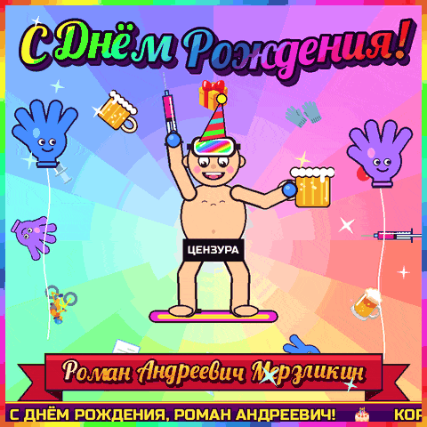

# 🎂 Гифка для Романа Андреевича Мерзликина

Ультракринжовое поздравление: квадрат 480×480, ~19 секунд, крутится бесконечно.



- `roman_bday.gif` — сама гифка (~6.6 МБ)
- `roman_bday.mp4` — то же самое в 960×960: в Telegram/WhatsApp лучше кидать его, он легче и чётче
- `make_gif.py` — генератор, всё нарисовано кодом
- `fonts/` — шрифты с кириллицей из Google Fonts (лицензия OFL, тексты лицензий рядом)

## Что внутри

1. **Всё вместе.** Крутится радужное солнце. Роман Андреевич голый (под плашкой «ЦЕНЗУРА»), в синих нитриловых перчатках, в колпаке и маске, стоит на сноуборде. В одной руке шприц, как факел, в другой кружка пива. Вокруг летают шприцы, перчатки, велик и документы, по бокам висят перчатки-шарики, сверху «С Днём Рождения!» в стиле WordArt.
2. **Итоги тендера.** Протокол № ДР-2026: предмет закупки — поставка поздравлений с Днём рождения, НМЦК — бесценно, обеспечение исполнения — ящик пива. Шлёп — печать «ПОБЕДИТЕЛЬ», и во все стороны разлетаются шприцы с перчатками.
3. **Зимой — гроза склонов, летом — гроза велодорожек.** Экран расколот молнией пополам.
4. **Дома — в чём мать родила.** На фоне ковра на стене, с плашкой «КОММЕРЧЕСКАЯ ТАЙНА» и стикером «Дресс-код: не предусмотрен техзаданием».
5. **Дней без пива.** Счётчик («попытка №26») тикает 1, 2, 3, 4, 5… и на последней строчке стиха сбрасывается в 0. Кружки чокаются: «БУДЕМ!»

Сцены сменяются переходами в духе PowerPoint 2003: звезда, сердечко, часы, вертушка. Внизу всё время бежит строка с титулами именинника.

Четверостишие:

> Бросать пивко — совсем не сложно:
> Роман бросал раз двадцать пять!
> Ведь без пивка прожить-то можно...
> Но тендер взят — и пьёт опять!

## Пересобрать

```bash
pip install pillow numpy    # Pillow 10+
python3 make_gif.py
```

Для mp4 нужен `ffmpeg`, для сжатия гифки — `gifsicle` (без него выйдет около 8.5 МБ). Цветные эмодзи берутся из системного шрифта Noto Color Emoji; если его нет, эмодзи просто пропадут.

Полезные ключи: `--size 540` (сторона квадрата), `--colors 255 --lossy 0` (качество важнее веса), `--sheet preview.png` (раскадровка вместо гифки).

### Максимальная всратость

Положи рядом со скриптом `face.jpg` (квадратное фото, лицо крупно по центру) и перезапусти. Настоящее лицо Романа Андреевича вклеится вместо нарисованного во всех сценах, включая фото в протоколе. `face.*` добавлены в `.gitignore`, чтобы фотка случайно не уехала в репозиторий.
